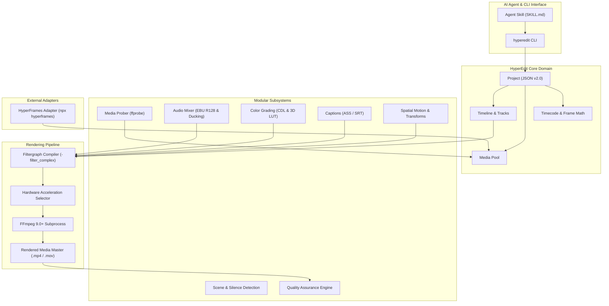

# HyperEdit Pro Technical Architecture

## 1. Architectural Mission & Principles

HyperEdit Pro is designed as a native non-linear video editing and audiovisual post-production engine for autonomous AI coding agents (such as Codex, Claude Code, Cursor, Gemini CLI).

### Core Architectural Principles
1. **Frame-Accurate Determinism**: All temporal positions are tracked in integer frame counts calculated against an immutable base frame rate. Floating-point seconds are derived properties, never internal keys.
2. **Modular Decoupling**: Each domain responsibility (media probing, timeline editing, audio mixing, color grading, subtitles, QA) is isolated behind explicit Python `typing.Protocol` interfaces.
3. **Hardware Acceleration First**: The render engine automatically detects and prioritizes hardware encoders (NVIDIA NVENC, Intel QuickSync, Apple VideoToolbox, AMD AMF, Linux VAAPI) before falling back to software CPU encoding.
4. **Local & Autonomous**: The entire platform operates strictly locally without mandatory reliance on external paid cloud APIs.
5. **HyperFrames Symbiosis**: HyperEdit Pro serves as the multi-track NLE and audiovisual master layer, while HyperFrames functions as the HTML-to-video generative motion graphic renderer.

---

## 2. System Block Diagram

---

## 3. Subsystem Breakdown

### 3.1 Media Prober (`hyperedit.media.prober`)
Executes `ffprobe` in JSON output mode to extract exact stream parameters: video resolution, container format, pixel format, duration, audio sample rates, channels, and stream indexes.

### 3.2 Timeline Engine (`hyperedit.timeline`)
Maintains ordered tracks (`video`, `audio`, `subtitle`, `graphic`, `adjustment`) and non-overlapping clips. Handles temporal splits, ripple deletions, inserts, and clip transition alignments.

### 3.3 Audio DSP & Mixing (`hyperedit.audio`)
Generates FFmpeg audio filtergraphs for:
- Independent track volume faders in decibels (`volume=XdB`).
- Sidechain ducking (`sidechaincompress`) where dialogue automatically attenuates music.
- Dual-pass or single-pass EBU R128 loudness normalization (`loudnorm=I=-23:LRA=7:TP=-1.0`).

### 3.4 Color Science Engine (`hyperedit.color`)
Applies color transforms without roundtripping through external GUI software:
- Exposure and contrast adjustments.
- ASC Color Decision List (`slope`, `offset`, `power`, `saturation`).
- 3D LUT application (.cube) using tetrahedral interpolation.

### 3.5 Rendering & Filtergraph Engine (`hyperedit.rendering`)
Compiles the timeline into a single, deterministic FFmpeg command with complex filter graph (`-filter_complex`), maps streams to audio/video master buses, applies hardware acceleration flags, and monitors execution.

### 3.6 External Adapters (`hyperedit.adapters`)
Provides clean integration with sibling tools:
- **HyperFrames Adapter**: Automatically detects Node.js / HyperFrames CLI, triggers headless rendering of DOM compositions to transparent ProRes 4444 video files, and mounts them onto timeline graphic tracks.

